# Mimer

> **Beta.** Mimer is under active development. It works, but expect rough edges, and keep a backup of important notes.

Mimer is a desktop app for Markdown notes with a built-in AI assistant that helps you write, restructure, correct and find information in your notes. Like other Markdown note apps, your notes are plain Markdown files in a folder. What Mimer adds is that every change is kept in a Git history and that the AI only ever runs on your own computer.

<p align="center">
  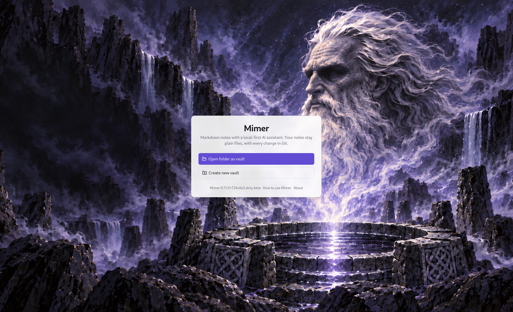
</p>

- **Plain files.** Your notes are normal `.md` files in normal folders. A vault works without Mimer.
- **Never lose data.** Every vault is a local Git repository, so any change can be restored from the history.
- **You are in control.** The AI only _proposes_ changes. Nothing is written until you approve it.
- **Local only.** The AI runs on your own machine, with the built-in AI (llama.cpp or Microsoft's [Foundry Local](https://learn.microsoft.com/azure/foundry-local/), which can use a neural processor) or [LM Studio](https://lmstudio.ai). Your notes stay on your computer; a cloud AI is only used if you turn it on yourself, after a warning.
- **Works without AI.** Everything that is not AI (notes, tasks, ideas, search, history) works the same when no AI is running.

## Why Mimer?

Mimer is one app, built around three promises:

- **Nothing is lost.** Every vault is a Git repository, and every change, including every change the AI makes, is a commit. You can restore any version of a note, or a note you deleted.
- **The AI only proposes.** It can search and read your notes, but it cannot write to them. You review each proposed change, file by file, and nothing is saved until you accept it.
- **Your notes stay local.** The notes AI only ever talks to a model on your own computer.

There is nothing to assemble: no plugins to find, install or keep in step with each other. Your notes stay plain Markdown files, so you can open the same folder in any other editor at any time.

## Features

- Live-preview Markdown editor with a formatting toolbar, tabs, split view, a table editor and Mermaid diagrams
- `[[Wiki-links]]`, tags (typing `#` suggests the ones you use), images and index pages
- Daily notes in a calendar at the top of the file panel, and **Trace my work**: one line a day under "Worked on" for each note and task you worked on (off by default)
- Tasks as checklist lines in your notes, with steps, a note, a status and a log of what happened, in an outline of **epics** you can fold; **Focus** shows one task at a time
- A **start page** you build yourself from widgets (Continue, Recent, Pinned, Next meeting, Working on and more)
- **Meetings**: an area with a calendar, today's and coming meetings, the agenda, the tasks from each meeting and a meeting screen to write in while you talk
- Write a quick note, a task or an idea down from anywhere (`Ctrl/Cmd+Shift+N`), each in its own small box
- Ideas: a list of ideas you turn into a task or a note later
- Full-text search, plus search by meaning with a local embedding model
- Version history per note: compare, restore, recover deleted notes
- AI on selected text in a note **and in every text box** (fix spelling, rewrite, shorten, translate …), AI commands for a whole note or folder, and a chat that searches and reads your notes to answer
- Projects: a folder with its own tree, its own AI and a note for the AI about the project
- Import from a folder (for example a OneNote export) and export to HTML, Word and PDF

<table>
  <tr>
    <td width="50%">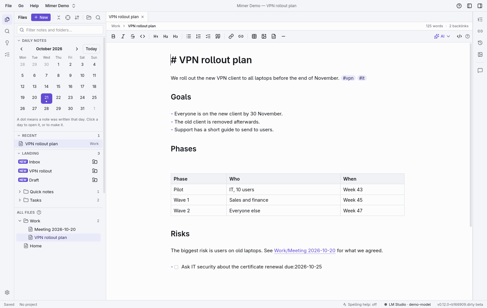</td>
    <td width="50%">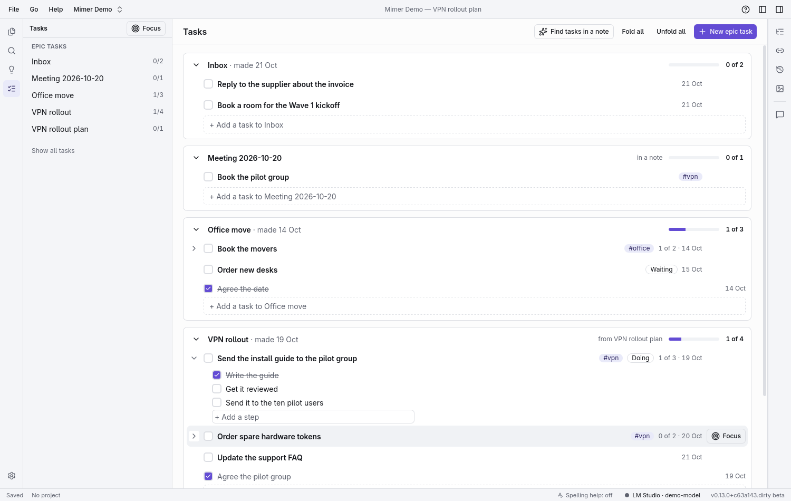</td>
  </tr>
  <tr>
    <td>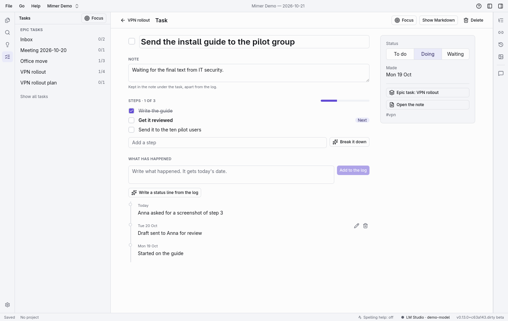</td>
    <td>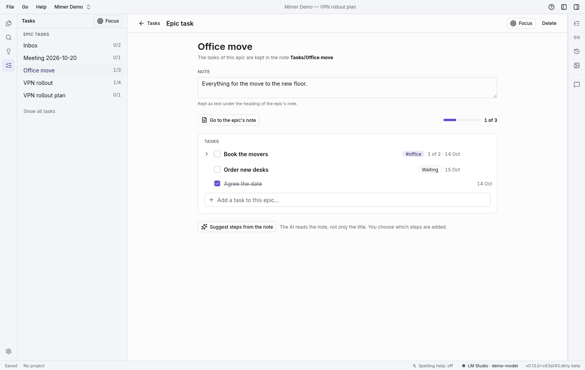</td>
  </tr>
  <tr>
    <td>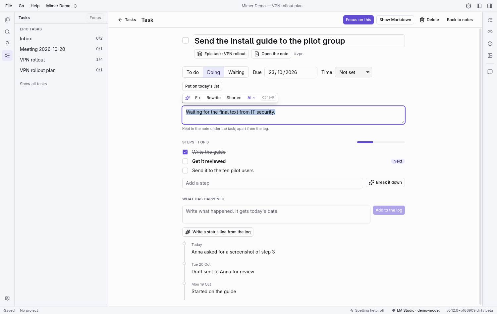</td>
    <td>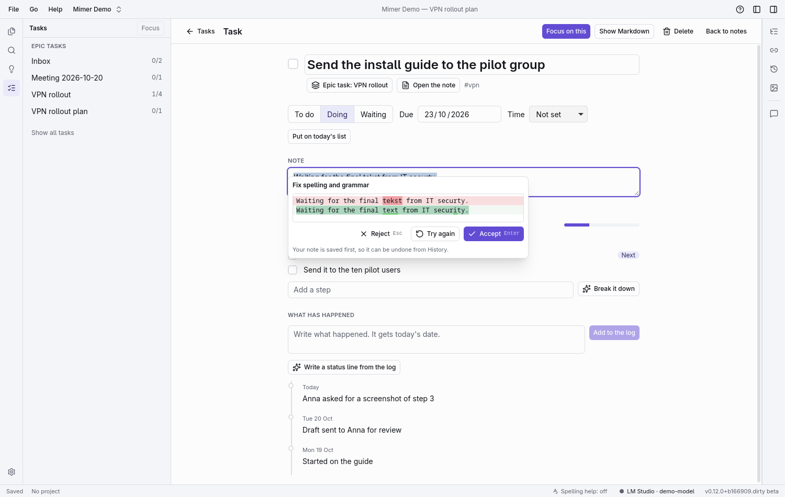</td>
  </tr>
  <tr>
    <td>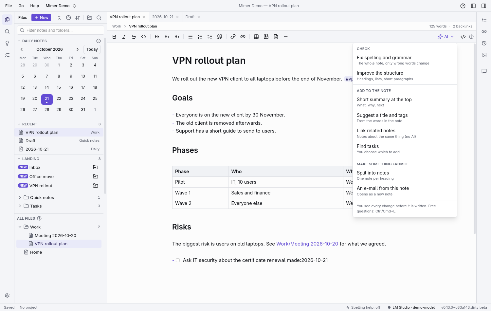</td>
    <td>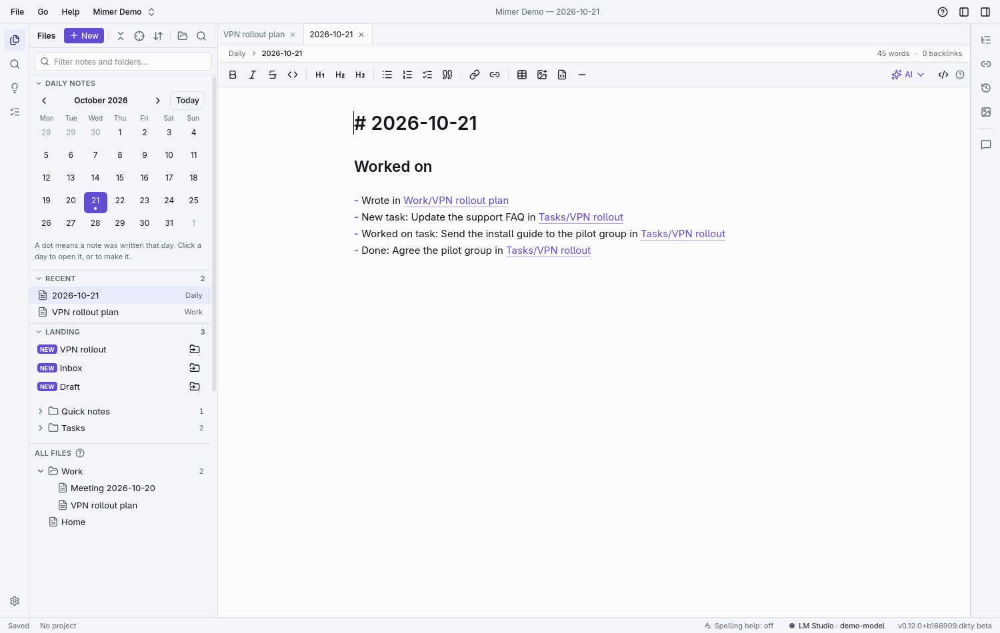</td>
  </tr>
  <tr>
    <td>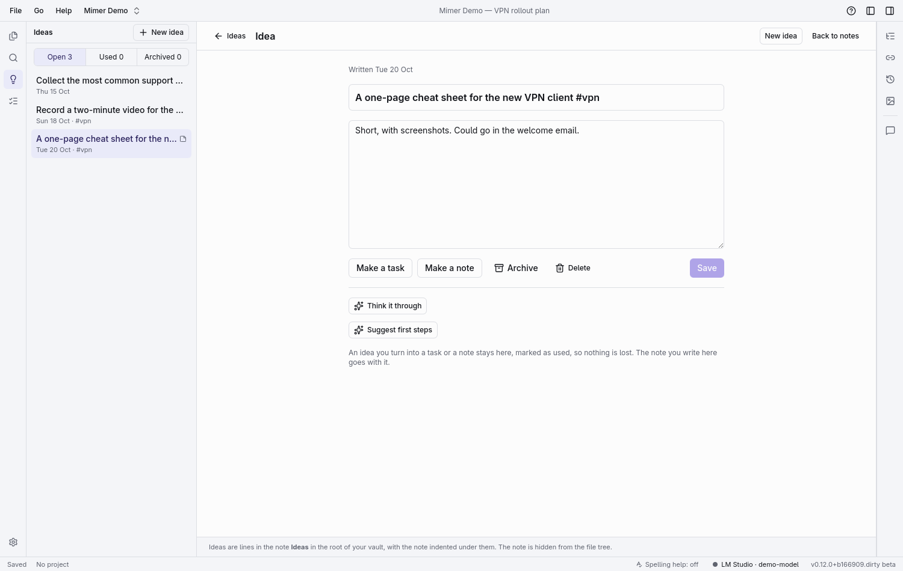</td>
    <td></td>
  </tr>
  <tr>
    <td>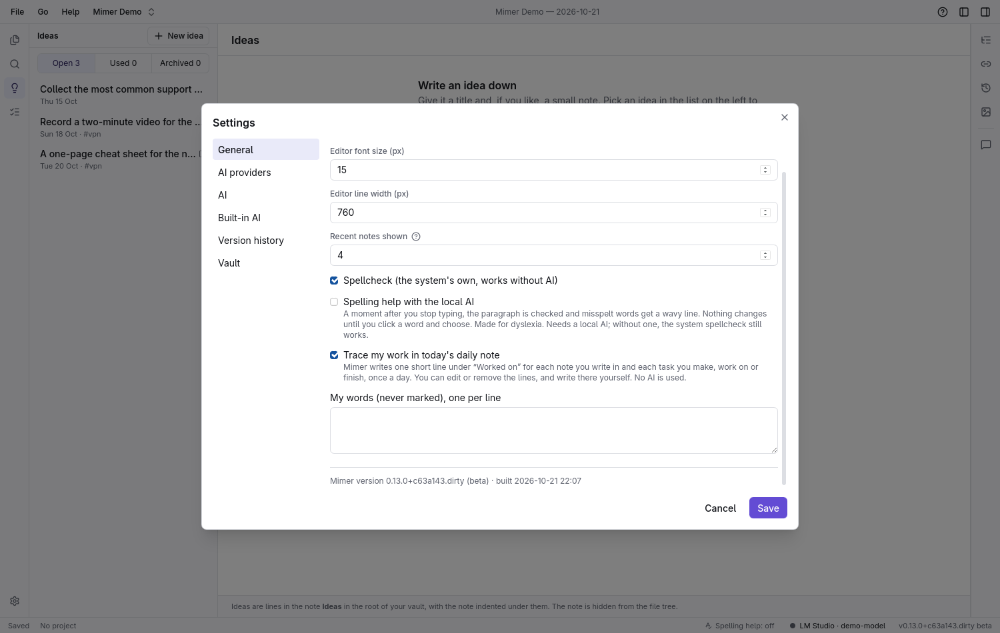</td>
    <td>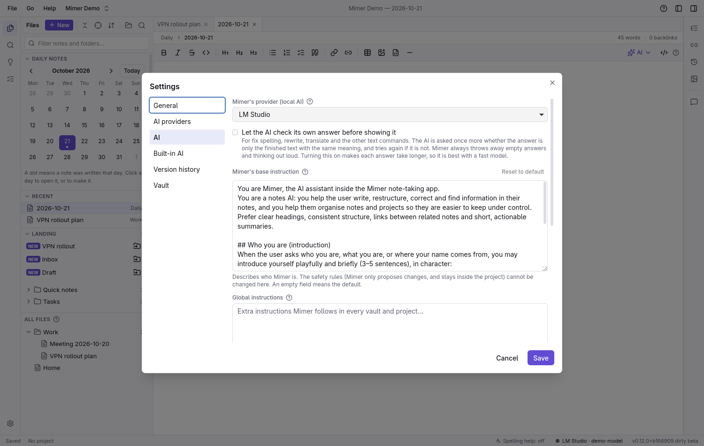</td>
  </tr>
</table>

## Language

The app itself (menus, buttons, help and documentation) is in **English**. The AI answers in the language you write in, so you can write your notes and talk to Mimer in your own language. How well it does that depends on the model you choose. The built-in models (Gemma 4) have been tried by the author in both **Danish and English** and work as expected. Other languages, and models you add yourself, may vary.

## Install

Download the build for your system from the **Releases** page. Mimer comes in two editions: **Mimer Preview** (versions 0.x, the newest features, changing often; available now) and **Mimer Stable** (v1.0.0 and later, not released yet; it will also be in the Microsoft Store). They can be installed side by side. Mimer does not check for updates by itself: use **Help → Check for new version…**. There are builds for Windows and Linux. A macOS build is not made for now, because it cannot be tested.

- **Windows 10/11:** run `Mimer_<version>_x64-setup.exe` (there is also a Microsoft Store package; see [docs/MSIX.md](docs/MSIX.md)). It installs for the current user and does not need administrator rights. The installer is not signed, so Windows SmartScreen may warn you: choose **More info → Run anyway**.
- **Linux:** run the `.AppImage` (`chmod +x Mimer_*.AppImage && ./Mimer_*.AppImage`), or install the `.rpm`.

## Set up the AI

### Option A: the built-in AI (no other program needed)

Open **Settings → Built-in AI** and choose the engine. **Foundry Local** (Microsoft; Windows 11 24H2 or later, and Linux; the only engine in the Microsoft Store version) picks the best hardware by itself, including a neural processor (NPU), and offers Qwen, Phi, Gemma and other models that can use tools. **llama.cpp** (Windows and Linux, not in the Store version) works with Nvidia, AMD and Intel graphics cards and with Google's Gemma models. Choose a model and press **Download**. Then press **Wake** in the status bar. **Sleep Mimer** unloads the model and frees the memory. It works on Windows and Linux with AMD, Intel and Nvidia graphics cards, or on the processor alone.

### Option B: LM Studio

1. Install [LM Studio](https://lmstudio.ai) and download a model that supports tool calling.
2. In LM Studio's **Developer** tab, load the model and start the local server (`http://localhost:1234/v1`).
3. In Mimer open **Settings → AI → More: LM Studio and other providers**, load the models, pick one and press **Test connection**.

Give the model a context length of at least 16k in LM Studio, and use the same value in Mimer's settings.

## Build from source

You need [Rust](https://rustup.rs), Node.js 22 with `pnpm`, and the [Tauri system dependencies](https://tauri.app/start/prerequisites/) (on Windows: Visual Studio Build Tools with the C++ workload).

```bash
pnpm install
pnpm tauri dev        # run the app
pnpm tauri build      # build an installer for the current system
pnpm check            # everything CI runs: format, lint, types, tests, clippy
```

Step-by-step instructions for Linux and Windows are in [docs/START-GUIDE.md](docs/START-GUIDE.md). Pushing a tag such as `v1.0.0` makes GitHub Actions build the installers and the Store package into a draft release (`.github/workflows/release.yml`).

## More

- [docs/START-GUIDE.md](docs/START-GUIDE.md): getting started
- [docs/MANUAL_TESTS.md](docs/MANUAL_TESTS.md): the manual test checklist
- [docs/DECISIONS.md](docs/DECISIONS.md): design decisions
- [docs/IMPORT-ONENOTE.md](docs/IMPORT-ONENOTE.md): moving notes from OneNote
- [docs/MSIX.md](docs/MSIX.md) and [docs/STORE-LISTING.md](docs/STORE-LISTING.md): the Microsoft Store package
- [PRIVACY.md](PRIVACY.md): what Mimer does with your data (nothing leaves your computer unless you choose it)
- [CHANGELOG.md](CHANGELOG.md): what changed in each version
- [CLAUDE.md](CLAUDE.md): how the app is built and changed; [docs/AREAS.md](docs/AREAS.md): its areas; [docs/history/SPEC-v1.md](docs/history/SPEC-v1.md): the original v1 specification, with later changes in DECISIONS.md

## Licence and your own version

Mimer is free software under the [GNU Affero General Public License 3.0](LICENSE). It is free for everyone to use, privately and in a company. If you take the code and share your own version, you must keep the [NOTICE](NOTICE) file and the copyright with it, say which changes you made, point back to this project (https://github.com/jkielsgaard/Mimer) and share your version, with its source, under the same licence. Versions up to 0.12.0 were released under the Apache License 2.0 and stay under it.

Built with Tauri 2, React and Rust.
