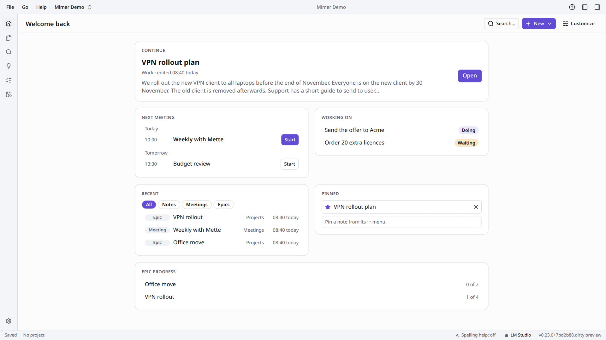
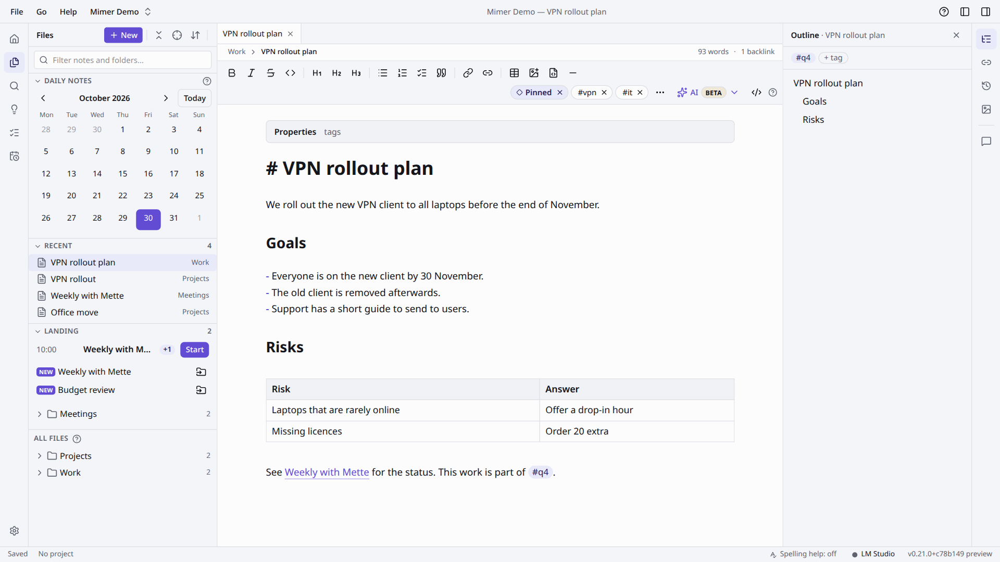
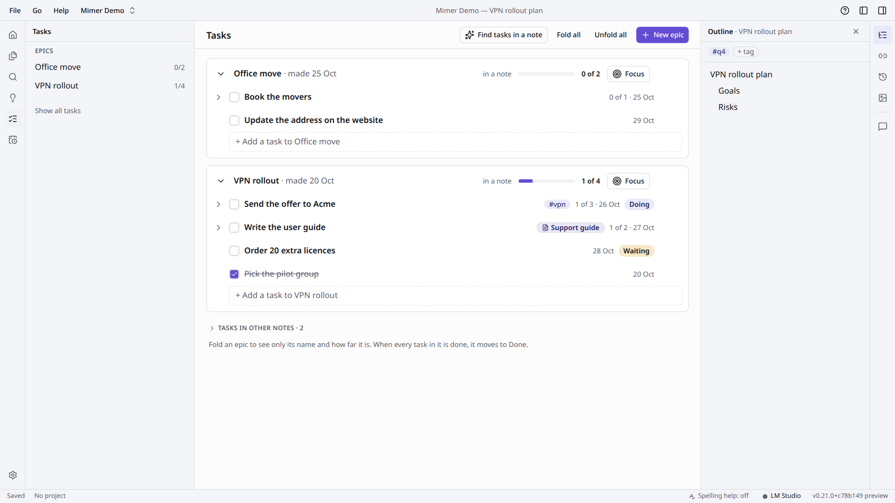
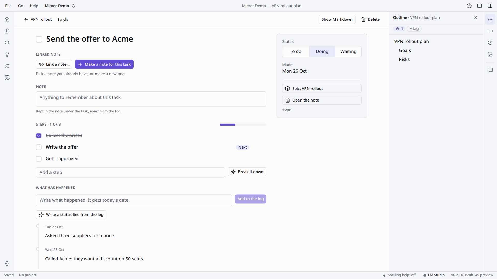
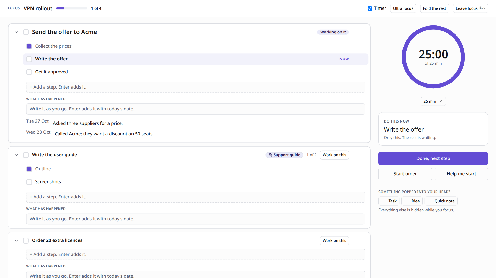
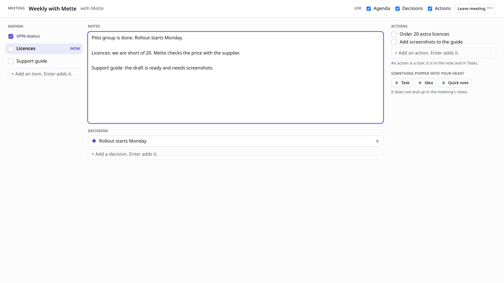
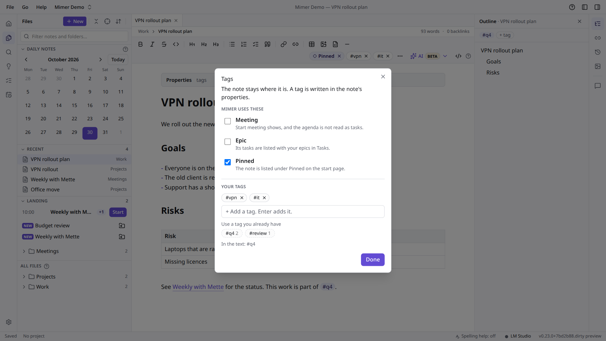
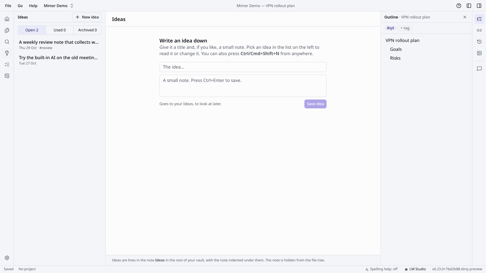
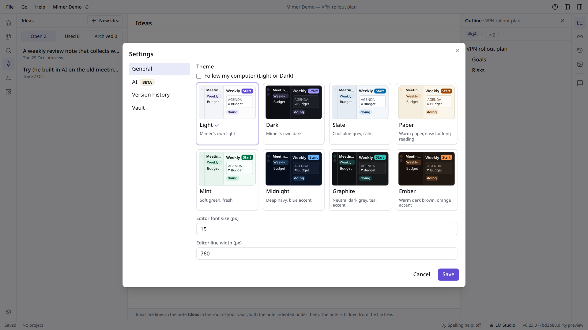
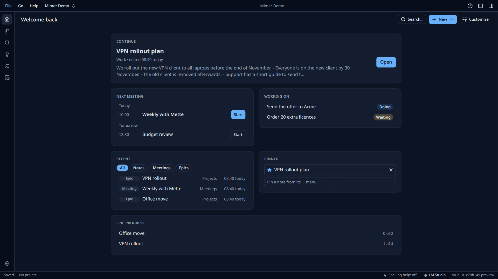

# Mimer

> **Beta.** Mimer is under active development. It works, but expect rough edges, and keep a backup of important notes.

Mimer keeps your notes as plain Markdown files, with tasks, meetings and an AI that runs on your own computer and only ever suggests.

The short overview, with downloads, is on the website: **https://jkielsgaard.github.io/Mimer/**. This page is the longer, technical one: what Mimer does, how your notes are stored, how to install it and set up the AI, and how to build it.

<p align="center">
  
</p>

## What it is built around

- **Plain files.** Your notes are normal `.md` files in normal folders. A vault works without Mimer. Open your vault in any other editor, any day. There is no database to export and no format to escape from.
- **Nothing is lost.** Every vault is a local Git repository. Every change is saved in a built-in Git history. Bring back any version of a note, or a note you deleted.
- **You are in control.** The AI never changes a note on its own. Every change is a proposal you review. You go through it file by file, and nothing is written until you accept it.
- **Your notes stay local.** The AI reads your notes only on your own machine. A cloud AI is possible, but only after you say yes, and never in a project you lock to local. Mimer does not phone home. There is nothing to sign up for. See [PRIVACY.md](PRIVACY.md).
- **Works without AI.** Everything that is not AI (notes, tasks, meetings, ideas, tags, search, history) works the same when no AI is running. An AI button that cannot work is greyed out and says why.

There is nothing to assemble: no plugins to find, install or keep in step with each other.

## Two editions: Preview and Stable

Mimer comes in two editions. **Preview** (versions 0.x for now, later `1.x.y-preview.N`) is the newest work. **Stable** (v1.0.0 and later) is the finished release, and it is the one that will be in the Microsoft Store when it is out.

- **Mimer Stable:** The first finished release. Calm, tested and updated less often, so you are not asked to update all the time. It is not released yet. Until it is, the 0.x releases are also the ones in the Microsoft Store.
- **Mimer Preview:** The newest features, as they are built. It changes often.

They can be installed side by side, and your notes are plain files in both. A tag with a pre-release part (`v1.1.0-preview.1`) builds as "Mimer Preview" with its own settings folder, which it fills with a copy of the Stable settings the first time it starts. Vault formats only ever grow (new properties, never a changed old one), so both editions read the same vault. How releases are made is in [Build from source](#build-from-source) and [docs/DECISIONS.md](docs/DECISIONS.md).

Mimer never looks for updates by itself and sends nothing. Use Help → Check for new version… in the app to see if a newer version is out. It opens the releases page in your browser.

## Features

**Writing**

- A live-preview Markdown editor with a formatting toolbar, tabs, a split view, a table editor, Mermaid diagrams, a Markdown source view (`Ctrl/Cmd+Alt+M`), pictures with a size bar, and `[[wiki-links]]` with autocomplete and link updates when a note is renamed or moved.
- A new note is named by its title. Names Windows cannot keep (a dot at the end, `CON`, `NUL`, `\ / : * ? " < > |`) are refused on every system, so a vault works everywhere.
- Daily notes in a calendar at the top of the file panel, and **Trace my work**: one line a day under "Worked on" for each note and task you worked on (off by default).
- A **start page** you build yourself from widgets (Continue, Recent, Pinned, Write it down, Search and ask, Next meeting, Working on, To sort, Areas, Changed since yesterday, Epic progress).
- Eight themes: Light, Dark, Slate, Paper, Mint, Midnight, Graphite and Ember, or follow the computer.
- **Reading** settings: line spacing, letter spacing, font, and **Follow the line**, which dims every line but the one you are in. A choice shows at once and Cancel puts it back.

**Tasks and ideas**

- A task is a checklist line in any note. Mimer reads them in every note and shows an outline of **epics** you can fold, each with its progress. A note is an epic when it has the tag `epic`.
- A task has steps (indented checklist lines), a note, a status (Doing, Waiting, Dropped), a day it was made and a log of what happened. **Break it down** lets the AI propose steps you choose from. **Focus** shows one task at a time, with an optional timer and an Ultra focus for a single task.
- A task that is **Waiting** can say who or what it waits for, and which other task it waits for. That task says which tasks wait for it, and the waiting one says **Ready** when it is done.
- The task list has filters (All, Doing, Waiting, Next up). Done tasks sit last in their epic, a folded epic is a small card with what is next and what is waited for, and epics where nothing has happened for 14 days are listed apart.
- **Where you left off:** leaving Focus asks for the next step in one line. It shows on the task and on the start page's Continue card.
- A task can point at a note with a `[[wiki-link]]` in its own line. Tasks and steps can be put in your own order.
- **Write it down** from anywhere (`Ctrl/Cmd+Shift+N`): a quick note, a task or an idea, each in its own small box. Ideas are a list you turn into a task or a note later.
- **A taskbar helper (Windows, off until you turn it on).** An icon in the taskbar and keys that work in every program: write something down, and say where you left off. You choose the keys under Settings → General, and the settings tell you if another program uses them. Mimer can stay in the taskbar when the window is closed. On other systems it is greyed out.

**Meetings**

- A meeting is a note with the tag `meeting`. The Meetings area has a calendar, then Today, Upcoming and Past, and a meeting screen to write in while you talk.
- The notes are one text for the whole meeting. **Agenda**, **Decisions** and **Actions** are parts you turn on, in the meeting or when you make it. An action is a task, so it is also in Tasks. **Prepare next meeting…** carries over what was not reached.
- A time is picked from a list of every quarter of an hour, or typed (`14:30`, `1430`, `2:30 pm`).

**Tags and search**

- Tags are written in a note's properties (`tags: [vpn]`) or as `#vpn` in the text, and they are the same tag. You choose your own tags; Mimer has three of its own, **Meeting**, **Epic** and **Pinned**, which change what Mimer does with the note and are shown apart, with what each one does. Meeting and Epic are written in the note; a pin is kept in `.vault/meta.json`.
- Full-text search with `tag:` and `path:` filters, and optional search by meaning with a local embedding model. **Answer from my notes** answers a question from the notes that fit.

**History and AI**

- Version history per note: compare, restore, recover deleted notes. Every AI change is a commit and can be undone.
- AI on selected text in a note **and in every text box** (fix spelling, rewrite, shorten, translate, explain, draw as a diagram and more), **In short** for a whole note (the main points and the things to do, and you tick which become tasks), AI commands for a whole note or folder (spelling, structure, summary, a title and tags, sort into folders), skills that Mimer carries out note by note, and a chat that searches and reads your notes to answer. Mimer checks every change a skill makes (links, tags, numbers, dates, code) before it is offered.
- **Test it** under each AI in Settings → AI asks one short question, with none of your notes, and shows the answer or the error in plain words. The built-in AIs are marked Beta.
- **Spelling help** that marks misspelt words in the language of the text and never changes anything by itself.
- Projects: a folder with its own tree, its own AI and a note for the AI about the project.
- Import from a folder (for example a OneNote export, see [docs/IMPORT-ONENOTE.md](docs/IMPORT-ONENOTE.md)) and export to HTML, Word and PDF.

<table>
  <tr>
    <td width="50%"></td>
    <td width="50%"></td>
  </tr>
  <tr>
    <td></td>
    <td></td>
  </tr>
  <tr>
    <td></td>
    <td></td>
  </tr>
  <tr>
    <td></td>
    <td></td>
  </tr>
  <tr>
    <td colspan="2"></td>
  </tr>
</table>

## How your notes are stored

Everything is a Markdown file; Mimer adds a few lines of properties at the top of a note and nothing else.

```markdown
---
tags: [meeting, vpn]
meeting: 2026-10-30 10:00
with: [Mette]
parts: [agenda, decisions, actions]
---

# Weekly with Mette

## Agenda

- [x] VPN status
- [ ] Licences

## Notes

Pilot group is done. Rollout starts Monday.

## Decisions

- Rollout starts Monday

## Actions

- [ ] Order 20 extra licences made:2026-10-30
```

- **Tasks.** `- [ ] Send the offer status:doing made:2026-10-26 #vpn [[Offer to Acme]]`. Indented checklist lines are the steps, indented dated list items (`- 2026-10-28 Called Acme`) are the log, and indented text is the task's note. Mimer changes the note's own lines, so the file stays readable in any editor. What a waiting task waits for and the history of its status are not in the line: they are in `.vault/meta.json`.
- **Epics.** A note with the tag `epic`. **Ideas** are dated lines in a hidden note `Ideas.md` in the vault root.
- **Tags.** In `tags:` or as `#tag` in the text. Mimer's own tags are `meeting`, `epic` and `pinned`; every other tag is yours. A rewrite by the AI never adds or takes away Mimer's tags.
- **Meetings.** The properties above; `parts:` says which of Agenda, Decisions and Actions the meeting has (a meeting without it has all three).
- **The vault.** `.vault/` holds the vault's settings, templates, your own order (`order.json`) and what Mimer keeps outside your notes (`meta.json`: the pinned notes, what tasks wait for and the history of their status), all plain text and committed; the saved chats and the embedding index are kept there too but are not committed. The history is a normal Git repository in `.git/`.

## Language

The app itself (menus, buttons, help and documentation) is in **English**. The AI answers in the language you write in, or in the language you choose under **Settings → AI**, so you can write your notes and talk to Mimer in your own language. How well it does that depends on the model you choose. The built-in models (Gemma 4) have been tried by the author in both **Danish and English** and work as expected. Other languages, and models you add yourself, may vary.

## Install

Download the build for your system from the **Releases** page. There are builds for Windows and Linux. A macOS build is not made for now, because it cannot be tested.

- **Windows 10/11:** run `Mimer_<version>_x64-setup.exe` (there is also a Microsoft Store package; see [docs/MSIX.md](docs/MSIX.md)). It installs for the current user and does not need administrator rights. The installer is not signed, so Windows SmartScreen may warn you: choose **More info → Run anyway**.
- **Linux:** run the `.AppImage` (`chmod +x Mimer_*.AppImage && ./Mimer_*.AppImage`), or install the `.rpm`.

## Set up the AI

### Option A: the built-in AI (no other program needed)

Open **Settings → AI** and choose the engine. **Foundry Local** (Microsoft; Windows 11 24H2 or later, and Linux; the only engine in the Microsoft Store version) picks the best hardware by itself, including a neural processor (NPU), and offers Qwen, Phi, Gemma and other models. The first time, it asks before it downloads the hardware parts from Microsoft. **llama.cpp** (Windows and Linux, not in the Store version) works with Nvidia, AMD and Intel graphics cards and with Google's Gemma models. Choose a model and press **Download**, then press **Wake** in the status bar. **Unload AI** unloads the model and frees the memory. On a Copilot+ PC, the Store version can also use **Phi Silica**, the small model built into Windows.

### Option B: LM Studio

1. Install [LM Studio](https://lmstudio.ai) and download a model that supports tool calling.
2. In LM Studio's **Developer** tab, load the model and start the local server (`http://localhost:1234/v1`).
3. In Mimer open **Settings → AI → LM Studio, or another AI on this computer**, load the models, pick one and press **Test connection**.

Give the model a context length of at least 16k in LM Studio, and use the same value in Mimer's settings.

### Cloud AI, only if you choose it

A cloud service with an OpenAI-compatible interface can be Mimer's AI when nothing on the computer is good enough. Mimer first says what is sent and that it is your responsibility, and uses it only after you tick "I understand". The status bar shows **Cloud AI** while it is on, and a project marked **Local AI only** never uses it.

## Build from source

You need [Rust](https://rustup.rs), Node.js 22 with `pnpm`, and the [Tauri system dependencies](https://tauri.app/start/prerequisites/) (on Windows: Visual Studio Build Tools with the C++ workload).

```bash
pnpm install
pnpm tauri dev        # run the app
pnpm tauri build      # build an installer for the current system
pnpm check            # everything CI runs: format, lint, types, tests, clippy
```

Step-by-step instructions for Linux and Windows are in [docs/START-GUIDE.md](docs/START-GUIDE.md).

**Releases.** Pushing a tag makes GitHub Actions build the installers (and, for Stable and the 0.x releases, the Microsoft Store package) into a draft release (`.github/workflows/release.yml`). A tag such as `v0.21.0` or `v1.1.0-preview.1` is a Preview release; a plain tag such as `v1.0.0` is a Stable release, which waits for the owner's approval in GitHub before it is built. The tag must match the version in `package.json`. The website is the folder `site/`, published by `.github/workflows/pages.yml`.

**How the app is made.** Tauri 2 with a Rust backend and a React 19 and TypeScript frontend. [docs/AREAS.md](docs/AREAS.md) maps the app into areas and the files that belong to each; every change starts from a brief, has a change plan and ends with a change report (`pnpm areas report`).

## More

- [docs/START-GUIDE.md](docs/START-GUIDE.md): getting started
- [docs/UX-GUIDE.md](docs/UX-GUIDE.md): how every screen looks and works
- [docs/MANUAL_TESTS.md](docs/MANUAL_TESTS.md): the manual test checklist
- [docs/DECISIONS.md](docs/DECISIONS.md): design decisions
- [docs/IMPORT-ONENOTE.md](docs/IMPORT-ONENOTE.md): moving notes from OneNote
- [docs/MSIX.md](docs/MSIX.md) and [docs/STORE-LISTING.md](docs/STORE-LISTING.md): the Microsoft Store package
- [docs/shared-facts.json](docs/shared-facts.json): the sentences the website and this page say in the same words
- [PRIVACY.md](PRIVACY.md): what Mimer does with your data (nothing leaves your computer unless you choose it)
- [CHANGELOG.md](CHANGELOG.md): what changed in each version
- [CLAUDE.md](CLAUDE.md): how the app is built and changed; [docs/history/SPEC-v1.md](docs/history/SPEC-v1.md): the original v1 specification, with later changes in DECISIONS.md

## Licence and your own version

Mimer is free and open source (AGPL-3.0). It is free for everyone to use, privately and in a company, under the [GNU Affero General Public License 3.0](LICENSE). If you take the code and share your own version, you must keep the [NOTICE](NOTICE) file and the copyright with it, say which changes you made, point back to this project (https://github.com/jkielsgaard/Mimer) and share your version, with its source, under the same licence. Versions up to 0.12.0 were released under the Apache License 2.0 and stay under it.

Built with Tauri 2, React and Rust.
