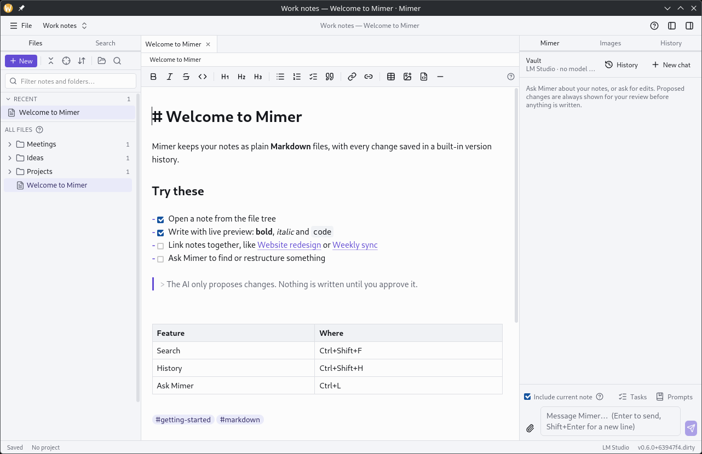

# Mimer

> **Beta.** Mimer is under active development. It works, but expect rough edges, and keep a backup of important notes.

Mimer is a desktop app for Markdown notes with a built-in AI assistant that helps you write, restructure, correct and find information in your notes. Like other Markdown note apps, your notes are plain Markdown files in a folder. What Mimer adds is that every change is kept in a Git history and that the AI runs on your own computer by default.



- **Plain files.** Your notes are normal `.md` files in normal folders. A vault works without Mimer.
- **Never lose data.** Every vault is a local Git repository, so any change can be restored from the history.
- **You are in control.** The AI only _proposes_ changes. Nothing is written until you approve it.
- **Local first.** The AI uses [LM Studio](https://lmstudio.ai) on your own machine. Cloud AI (Anthropic, OpenAI-compatible) is optional and can be blocked per project.

## Features

- Live-preview Markdown editor with a formatting toolbar, tabs, split view and a table editor
- `[[Wiki-links]]`, tags, images, templates and daily notes
- Full-text search, plus search by meaning with an embedding model
- Version history per note: compare, restore, recover deleted notes
- AI chat that can search and read your notes and propose edits you review file by file
- Inline AI commands on selected text (fix spelling, shorten, rewrite …)
- Projects: a folder with its own AI instructions and a "local AI only" lock
- Import from a folder (for example a OneNote export) and export to HTML, Word and PDF

## Install

Download the build for your system from the **Releases** page.

- **Windows 10/11:** run `Mimer_<version>_x64-setup.exe`. It installs for the current user and does not need administrator rights. The installer is not signed, so Windows SmartScreen may warn you: choose **More info → Run anyway**.
- **Linux:** run the `.AppImage` (`chmod +x Mimer_*.AppImage && ./Mimer_*.AppImage`), or install the `.rpm` / `.deb`.
- **macOS:** open the `.dmg`. The app is unsigned: right-click it and choose **Open** the first time.

## Set up the AI

1. Install [LM Studio](https://lmstudio.ai) and download a model that supports tool calling.
2. In LM Studio's **Developer** tab, load the model and start the local server (`http://localhost:1234/v1`).
3. In Mimer open **Settings → AI providers → LM Studio**, load the models, pick one and press **Test connection**.

Give the model a context length of at least 16k in LM Studio, and use the same value in Mimer's settings. API keys for cloud providers are stored in your system keychain, never in a file.

## Build from source

You need [Rust](https://rustup.rs), Node.js 22 with `pnpm`, and the [Tauri system dependencies](https://tauri.app/start/prerequisites/) (on Windows: Visual Studio Build Tools with the C++ workload).

```bash
pnpm install
pnpm tauri dev        # run the app
pnpm tauri build      # build an installer for the current system
pnpm check            # everything CI runs: format, lint, types, tests, clippy
```

Step-by-step instructions for Linux and Windows are in [docs/START-GUIDE.md](docs/START-GUIDE.md). Pushing a tag such as `v0.6.0` makes GitHub Actions build the installers (`.github/workflows/release.yml`).

## More

- [docs/START-GUIDE.md](docs/START-GUIDE.md): getting started
- [docs/MANUAL_TESTS.md](docs/MANUAL_TESTS.md): the manual test checklist
- [docs/DECISIONS.md](docs/DECISIONS.md): design decisions
- [CHANGELOG.md](CHANGELOG.md): what changed in each version
- [CLAUDE.md](CLAUDE.md): the full specification

## Licence and your own version

Mimer is open source under the [Apache License 2.0](LICENSE). You may use it, change it and make your own version, also a commercial one. If you share your version, keep the [NOTICE](NOTICE) file and the licence with it, say which changes you made, and point back to this project: https://github.com/jkielsgaard/Mimer.

Built with Tauri 2, React and Rust.
