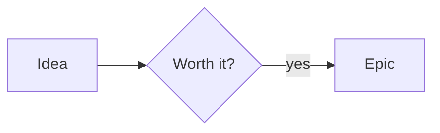

## The toolbar

Above every note is a toolbar. Select some text and click a button, or click first and type after. Clicking the same button again removes the formatting.

- **Text:** bold, italic, strikethrough, inline code.
- **Headings:** H1, H2, H3. Click the same heading again to go back to normal text.
- **Lists:** bullet list, numbered list, task list (with check boxes), quote.
- **Link** and **Link to a note** (see _Links and index pages_).
- **Table**, **Insert image**, **Code block**, **Horizontal line**.

## You do not have to know Markdown

Mimer shows your note nicely while you write: `**bold**` appears bold, and the marks are hidden when the cursor leaves the line. The buttons add the marks for you.

| You type     | You get                       |
| ------------ | ----------------------------- |
| `# Title`    | a big heading                 |
| `**word**`   | **bold**                      |
| `_word_`     | _italic_                      |
| `- item`     | a bullet list                 |
| `- [ ] task` | a task you can tick           |
| `> quote`    | a quote                       |
| `#tag`       | a tag you can click to search |

## Tables

Click **Insert table** (or press **Ctrl/Cmd+Alt+T**). Click in a cell and type. A toolbar above the table adds or removes rows and columns and sets alignment. Press **Tab** to go to the next cell.

## Tabs and two notes side by side

Every note you open gets a tab. Close with the **×** or **Ctrl/Cmd+W**. Press **Ctrl/Cmd+\\** to show two notes next to each other.

## See the Markdown

Click the **</>** button at the right end of the toolbar (or **Go → Show Markdown source**, or **Ctrl/Cmd+Alt+M**) to see the note exactly as it is stored: every `#`, `**` and `[[...]]` visible, in a monospace font. Click the eye button to go back to the formatted view. Mimer remembers your choice. Nothing in the note changes when you switch.

## Diagrams

A fenced block written with the language `mermaid` is drawn as a diagram while the cursor is somewhere else; click the picture to edit the code. It is plain Markdown (GitHub draws it too), and it is drawn on this computer. A diagram with a mistake shows what is wrong and its code.

````

````
